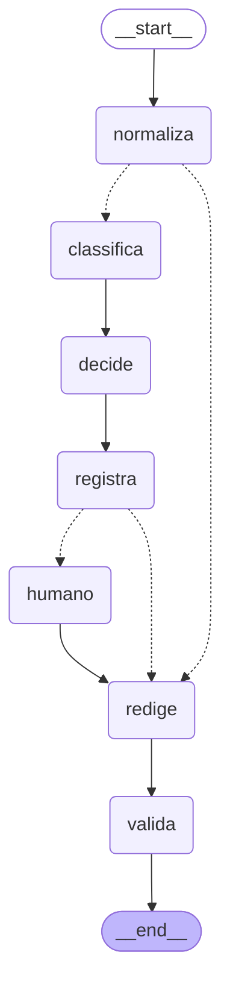

# triagem-langgraph

Triagem de atendimento com LangGraph: recebe o pedido do cliente, classifica, define setor e prazo, decide se resolve sozinho ou passa para uma pessoa, registra sem duplicar e responde com protocolo, sem prometer o que não sabe.

É a reimplementação em código Python de uma triagem que eu construí e que roda em produção em n8n, para um escritório de contabilidade. Aqui tudo é fictício: empresas, pessoas, pedidos e protocolos. O que roda em produção é a versão em n8n, não este repositório.

## O problema

O pedido chega por WhatsApp ou e-mail, em texto ou áudio. Cada um precisa de setor, prazo e protocolo, e às vezes de uma pessoa. Duas falhas aconteceram na versão em produção e foram corrigidas. Este projeto mostra as duas resolvidas por desenho:

1. **Status inventado.** O agente dizia que um pedido antigo "estava em análise" e prometia retorno, sem ter essa informação. Aqui a conversa só recebe o resumo dela, e um guardrail fora do prompt corta frase de andamento, promessa de retorno e promessa de canal de entrega.
2. **Pedido novo escondido.** Um pedido novo caía dentro de uma demanda antiga do mesmo setor e tipo, e sumia. Aqui o pedido novo vai para a frente do resumo, o anterior fica atrás, gera o evento `novo_pedido`, e repetir a mesma mensagem não duplica nada.

## O grafo

Diagrama gerado pelo próprio LangGraph (`python -m triagem --mermaid`). Linha tracejada é aresta condicional.



| Nó | O que faz |
|---|---|
| `normaliza` | Limpa o texto. Áudio chega transcrito com a marca `[audio]` e vira texto com origem `audio`. Mensagem vazia pula direto para a resposta. |
| `classifica` | Único ponto em que o modelo opina: devolve tipo, setor e confiança em saída estruturada (Pydantic). |
| `decide` | Regras em Python puro: prazo do setor em horas úteis, confiança abaixo de 0,7 ou reclamação vai para pessoa. |
| `registra` | Abre ou atualiza a demanda no SQLite. Pedido novo na frente, idempotência por chave. Pergunta de andamento não abre demanda. |
| `humano` | Para o grafo com `interrupt` e grava o estado. Volta com `Command(resume=...)`, mesmo depois de reiniciar o processo. |
| `redige` | Monta a resposta só com o que está registrado nesta conversa. |
| `valida` | Guardrail: tira a frase sem base. Se sobrar vazio ou faltar o protocolo, cai na frase mínima verdadeira. |

O estado de cada conversa fica no checkpointer SQLite (`thread_id` = id da conversa).

## Como rodar

Python 3.11 ou mais novo (testado em 3.14). Não precisa de chave de modelo.

```bash
python -m venv .venv
.venv/Scripts/activate        # Windows; no Linux e no Mac: source .venv/bin/activate
pip install -e ".[dev]"

python -m triagem "Preciso da guia do imposto deste mês"
python -m triagem "Quero cancelar, isso é um absurdo"
python -m triagem --retoma "Ana"
```

Saída de exemplo:

```text
caminho: normaliza -> classifica -> decide -> registra -> redige -> valida
resposta: Pedido registrado com o protocolo EX-00001, setor Fiscal. Prazo: 16/11 às 12h00.
```

Testes, lint e tipos:

```bash
pytest
ruff check . && ruff format --check .
mypy
```

## Decisões de desenho

- **Modelo só classifica.** Setor, prazo e "vai para pessoa" são regras em Python, testáveis e iguais toda vez. O modelo entra numa interface (`Modelo`) com duas funções; o padrão é `ModeloFalso`, determinístico, para teste e demonstração sem custo.
- **Guardrail fora do prompt.** Instrução no prompt reduz a chance de erro, não garante. O validador roda depois do modelo e corta a frase inteira, com o motivo registrado em `cortes`.
- **Idempotência no banco.** A chave é a conversa mais o texto normalizado, com `UNIQUE` no SQLite. Mensagem reenviada pelo WhatsApp não vira pedido duplicado.
- **Estado zerado a cada mensagem.** A conversa mantém o thread no checkpointer, mas cada mensagem entra com todos os campos zerados, para nada da volta anterior vazar na resposta.
- **Pergunta de andamento não cria demanda.** Responde com protocolo, setor e prazo registrados. Sem demanda registrada, vai para pessoa em vez de inventar.

## O que os testes cobrem

57 testes, sem rede e sem modelo:

- Regras: horas úteis (virada de dia, sexta para segunda, fim de semana, antes e depois do expediente), limiar de confiança, reclamação.
- Guardrail: frases do tipo que saiu em produção, frase verdadeira preservada, resposta padrão.
- Banco: idempotência, pedido novo na frente, isolamento entre conversas.
- Grafo: fluxo inteiro, estado zerado entre mensagens, interrupção e retomada depois de reiniciar com checkpointer em arquivo.
- Replay: 22 casos de borda em `tests/casos.jsonl`, incluindo rascunhos gravados (o texto que um modelo escreveu) para provar o guardrail sem chamar o modelo.

## Limites

- O `ModeloFalso` classifica por palavra-chave. Serve para testar o grafo, não substitui um modelo real.
- Não há adaptador para modelo real neste repositório. A interface `Modelo` é o ponto de encaixe (por exemplo `with_structured_output(Classificacao)` no LangChain).
- SQLite atende uma instância. Em escala, Postgres para demandas e checkpointer.
- Feriado não entra na conta de horas úteis.
- Mensagem nova numa conversa parada em `humano` não é tratada: a conversa precisa ser retomada antes.

## In English

LangGraph triage for customer requests: normalizes the message, classifies it (structured output), applies deterministic business rules (department, deadline in business hours, human handoff), stores requests idempotently in SQLite, drafts a reply with a ticket number, and runs an output guardrail that removes unfounded status updates and promises. Human handoff uses `interrupt` and resumes with `Command(resume=...)` from a SQLite checkpointer. It is a Python reimplementation, with fictitious data, of a triage flow I built that runs in production on n8n. Tests (57, including 22 replay cases) run without any model API key, using a deterministic fake model.
